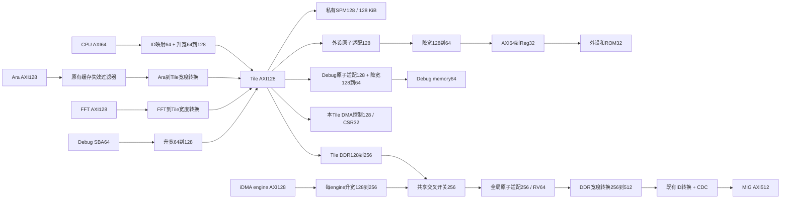

# Cheshire 分层总线位宽调整设计

日期：2026-10-19，Asia/Shanghai。

状态：用户已批准并完成RTL实施；实际验证范围与已知限制见[验证记录](../../wide_bus_rtl_verification.md)。

设计基线：服务器 `/home/user06/work/xinkailai/cheshire`，提交
`5838a51`。本地 Windows 工作区与服务器版本不同，本设计以服务器源码为准。

本轮包括设计文档、Cheshire RTL、原始FFT生成器扩展及仿真验证。不得据本文重置
`.bender`、重新准备依赖、覆盖历史FFT生成目录或执行依赖修改脚本。
FPGA综合、bitstream构建和实际上板仍属于后续工作。

## 1. 目标与边界

采用不同宽度域，通过 AXI 协议转换连接，保留已有程序和设备接口的语义。

- CPU 保持 RV64，缓存对外 AXI 保持 64 位。
- Ara 原生 AXI 为 128 位；本轮调整为 4 lane、VLEN=2048。
- FFT 数据端口为 128 位，目标算术核心为 4096 点、16 位输入、双采样软乘法、自然顺序。
- 共享 iDMA 数据端口为 128 位。
- Tile 交叉开关、私有 SPM 接口和 Tile DDR 出口为 128 位。
- 私有 SPM 总容量保持 128 KiB，地址及缓存/非缓存别名保持原值。
- 共享 DDR fabric 和全局原子适配器的数据接口为 256 位。
- 外设寄存器和 Boot ROM 为 32 位；Debug memory/SBA 保持 64 位。
- VCU118 MIG 侧 AXI 保持 512 位，DDR 引脚、MIG 配置和系统时钟不同时更改。
- 软件地址、ELF 字节布局、FFT 指令编码、FFT 内存格式、DMA CSR 合约保持兼容。

本轮Ara由2lane调整为4lane；不引入硬件cache coherence、独立时钟域、独立复位、
DMA访问私有SPM、Linux SMP或超时取消功能。128/256位方案的已测场景见验证记录，
未覆盖场景不能因参数化或某个Hello通过而视为已验证。

## 2. 调整前后对比

| 部分 | 当前 | 目标 | 注释 |
| --- | ---: | ---: | --- |
| CPU XLEN、寄存器和标量运算 | 64 | 64 | 不改变 ISA/ABI |
| CPU cache AXI | 64 | 64 | 64→128 接入 Tile |
| Ara AXI | 64 / 2 lane | 128 / 4 lane | VLEN保持2048，宽度独立配置 |
| FFT AXI | 64 | 128 | 两个结果组成一个完整写拍 |
| Tile AXI | 64 | 128 | WSTRB 从 8 增至 16 |
| SPM AXI | 64 | 128 | 仍为 128 KiB |
| Tile DDR 出口 | 64 | 128 | 每 Tile 独立升宽到共享域 |
| iDMA AXI | 64 | 128 | 每 engine 独立升宽 |
| DMA 控制 AXI | 64 | 128 | CSR 字段及自然软件访问仍为 32 位 |
| 共享 fabric | 64 | 256 | WSTRB 从 8 增至 32 |
| 全局原子适配器 AXI | 64 | 256 | RISC-V AMO/LRSC 仍为 32/64 位 |
| 外设桥前的局部 AXI | 64 | 64 | Tile128 先降宽，隔离外设桥 |
| Regbus/Boot ROM | 32 | 32 | 保留当前寄存器实现 |
| Debug memory/SBA | 64 | 64 | 双向边界分别适配 |
| MIG AXI | 512 | 512 | 256→512 后保持既有 ID/CDC 链 |
| CPU 地址、AXI ID 和 USER | 原配置 | 原配置 | 不随数据宽度自动扩展 |

“AXI128”表示 W/R 数据通道 128 位，不表示每笔操作都必须访问 16 字节。
CPU 的 1/2/4/8 字节访问仍需保留其 SIZE 和有效字节位置。

## 3. 总体连接

所有 Tile、DMA、转换器和共享 fabric 继续使用既有 SoC 时钟/复位。
现有 MIG 侧 CDC 保留，不增加其他时钟域。IRQ、UART、JTAG 串联拓扑不变。

## 4. 参数与类型设计

以下名称为建议新增接口，不是当前代码已有参数。

### 4.1 Tile 配置

保留 `Cfg.AxiDataWidth` 表示 Tile 主干宽度。不得再将它隐式当作所有端点的原生宽度。

| 配置字段 | 旧配置缺省 | 目标 profile | 所有者 |
| --- | ---: | ---: | --- |
| `AxiDataWidth` | 64 | 128 | Tile AXI/SPM/外部 Tile AXI |
| `CoreAxiDataWidth` | 64 | 64 | CVA6/cache/CPU侧ID序列化 |
| `AraAxiDataWidth` | 0 | 128 | 0 表示沿用 `32*AraNrLanes` 的旧行为 |
| `FftAxiDataWidth` | 0 | 128 | 0 表示跟随 Tile 宽度，保留旧配置行为 |
| `DbgAxiDataWidth` | 64 | 64 | Debug memory 与 SBA |

新增统一的有效宽度解析函数，处理 0 值继承。所有类型定义与实例参数必须使用
同一解析结果；禁止某处使用原始字段、另一处使用继承后的值。

寄存器宽度保持 32，外设桥局部 AXI 固定 64，本轮不将它们扩展成任意组合的配置面。
`DefaultCfg` 保持旧 profile；为目标多 Tile 仿真/FPGA入口新增或集中选择 wide profile，
避免改变不属于本次目标的单 Tile 板级配置。

### 4.2 共享域参数

`multi_tile_top`、`cheshire_shared_dma_subsystem` 显式传递：

- `DmaAxiDataWidth`：0 时继承 Tile 宽度，目标 profile 设为 128。
- `SharedAxiDataWidth`：0 时继承 Tile 宽度，目标 profile 设为 256。

`shared_dma_pool` 拆开控制端口宽度与 engine 数据宽度；frontend 按控制端口配置，
engine/midend/backend 按 DMA 数据端口配置。初始目标两者均为 128，但不能复用类型
而隐藏这种区别。

### 4.3 类型边界

- CPU native：64 位数据，原生 `Cva6IdWidth` ID。
- CPU mapped：64 位数据，`Cfg.AxiMstIdWidth` ID。
- Ara/FFT/Debug SBA native：各自宽度，Tile master ID 宽度。
- Tile master/slave/LLC：128 位数据，沿用各自 ID 扩展规则。
- DMA native：128 位数据，沿用 Tile LLC ID 宽度，防止无意改变共享 source 编码。
- Shared input：256 位数据，进入全局 xbar 前保留各源原 ID/USER。
- Shared output：256 位数据，ID 为输入 ID 位数加 `clog2(NumTiles+NumDmas)`。
- MIG：512 位数据及既有控制器 ID/地址转换结果。

每个转换器显式声明两侧 W/R 类型；AW/AR/B 在 ID 和地址相同的边界可复用类型。
不得通过 packed struct 强制转换、补零或截断来代替 AXI 宽度转换。

## 5. 公共协议合约

### 5.1 字节地址、SIZE 和 WSTRB

地址始终按字节编号。完整拍的 SIZE 为 64位=3、128位=4、256位=5、512位=6。
窄访问保留实际 SIZE；WSTRB 按地址低位定位有效字节，读数据按相同规则返回。
端点不得将窄读错误地扩大为包含额外设备副作用的读取。

128 位总线上 64 位 INCR burst 合法，每拍前进 8 字节，高低 64 位字节位置交替。
256 位总线上的 128 位或更窄事务同理。独立事务不会因为总线变宽而自动合并。

### 5.2 burst、边界和错误

- FFT 新数据路径使用 INCR burst；burst 不跨越 4 KiB 边界。
- 目标初始最大 burst 为 16 拍，首尾不对齐部分使用合法窄访问/掩码。
- 仅使用 WSTRB 不能修正本身不合法的 SIZE、地址或 burst 边界。
- 上游事务的所有下游响应完成后，才能返回对应 B/最终 R；禁止提前写确认。
- 保留 ID 顺序、USER/source、ATOP、LOCK 和错误状态，不因宽度转换丢失。
- 同 ID 顺序不变；不同 ID 的协议允许并发不代表软件获得额外的内存顺序保证。
- reset 和软件 timeout 不取消已被下游接受的写入，继续沿用当前协调复位边界。

### 5.3 现有转换器的限制

准备好的 `axi_dw_converter` 升宽路径不支持 WRAP，降宽路径不支持多拍 FIXED。
CPU/cache 实际发出的 burst 类型必须在接入前记录并检查；若出现不支持的类型，
应选择已证明兼容的转换路径或在项目 wrapper 内处理，不能静默返回错误并当作可用。
禁止未经授权修改依赖 RTL。

## 6. CPU64 接入 Tile128

当前 `gen_cva6_cfg`、CPU AXI类型、ID序列化器均使用 Tile 宽度，需要一起解耦。

推荐顺序：

`CVA6 AXI64 → 原有 bus error 观测 → USER/hart设置 → ID序列化64 → 升宽128 → 原有AXI RT → Tile入口guard → xbar128`。

- `gen_cva6_cfg` 使用有效 Core 宽度；I/D cache 配置、XLEN、cache line大小保持原值。
- `axi_id_serialize` 两侧数据宽度均为64，只改变ID；之后的宽度转换不再改变ID。
- 维护当前LR/SC guard的source/hart和地址别名规范化，位置关系不得使其观察错端口。
- 原有cache flush、guard-load写回排空语义保持。转换器不能提前返回B，否则原维护
  辅助函数的排空依据失效。

结构性依据：当前 WB `miss_handler` 的 bypass adapter 固定 `DATA_WIDTH=64`，
adapter内部按 `DATA_WIDTH/CVA6Cfg.AxiDataWidth` 定义数组。直接把CPU宽度设128不在本设计范围。

必测：ROM/SPM/DDR取指，跨16字节边界指令，load/store各SIZE和byte lane，cache refill/writeback，
异常，AMO.W/D，LR.W/D及SC.W/D，guard load和debug取指。

## 7. Ara128 与后续 lane 扩展

本轮 `AraNrLanes=4`、`AraVLEN=2048`、`AraAxiDataWidth=128`。Ara端口类型、VLSU参数
和失效过滤器类型使用同一有效宽度，再经过Ara→Tile转换器；目标配置为等宽透传。

Ara的lane内部仍是64位数据通路。增加AXI宽度不改变VLEN、SEW、寄存器分片或软件指令语义。
加载单元已有独立的AXI字节指针和VRF字节分配，但本组合仍需实际验证。

后续可单独测试 8 lane/AXI256。Tile128可通过256→128接8lane版本，
但其外部带宽受限；不要为将来扩容预先声称8lane在本轮已验证。

当前mask单元会拒绝1lane；`-U`和FFT双采样与Ara lane数量没有直接关系。

## 8. SPM128，容量保持128 KiB

| 参数 | 旧值 | 目标 |
| --- | ---: | ---: |
| ways | 8 | 8 |
| lines/way | 256 | 256 |
| blocks/line | 8 | 4 |
| bytes/block | 8 | 16 |
| bytes/line | 64 | 64 |
| SRAM words/way | 2048 | 1024 |
| 总字节数 | 131072 | 131072 |

保留 `0x10000000` 缓存别名和 `0x14000000` 非缓存别名及当前容量边界。
保留应用代码/BSS、应用栈、loader栈的原布局；容量寄存器仍报告131072。

宽度和几何参数通过统一profile选择，不能只修改SPM实例而让 `get_llc_size` 和
CPU可执行/缓存区域计算仍使用旧值。保持别名在reservation跟踪之前规范化。

`tc_sram` 按块宽和字节使能参数化，预期无需重写其实现；FPGA BRAM/URAM映射、
BIST周期和时序仍需重新测量，不能仅由总bit数相同推断资源/时序不变。

ROM loader逐字节复制和BSS清零必须保留。验收包括16个byte lane、部分写不破坏邻字节、
两个别名、边界拒绝、AMO/LRSC、BIST/all-SPM切换及ROM/SPM两种启动。

## 9. 外设与Boot ROM隔离域

保留现有AXI64→Reg32桥及其局部类型：

`Tile128 → 外设原子适配128 → cut → 降宽64 → AXI64到Reg32 → Reg32 demux`。

这样不把当前两bank寄存器桥直接扩大成四bank，避免扩大已有保留字读取和设备副作用范围。
局部64位接口仍需保留AXI slave ID宽度和错误返回。MMIO地址范围和32位CSR合约不变。

不能仅以“保留旧桥”代替副作用验证：对UART RX、PLIC claim、clear-on-read和命令写，
应比较旧/新路径实际发生的reg事务，保证窄访问没有新增邻接读取、重复提交或重复POP。
若现有桥不能满足目标合约，应在项目侧定义按SIZE选bank的适配改进，并单独评审，
而不是修改依赖或用零填充隐藏错误。

Boot ROM继续经Reg32访问。生成器、固件字节校验及ELF布局不变；RTL硬件变化后，
现有FPGA bitstream当然不能代表新设计，最终仍需重新实现。

## 10. Debug保持64位

两条路径必须分别适配：

- Slave：`Tile128 → 既有debug原子适配128/cut → 降宽64 → axi_to_mem_interleaved64 → dm_top64`。
- SBA：`dm_top64 → axi_from_mem64 → 升宽128 → Tile master输入`。

Debug地址扩展/截断、W/R/BE信号使用Debug局部类型，不能再使用Tile数据类型。
DMI接口、JTAG链、halt/resume和程序buffer协议不变。

当前依赖的dm_mem只实现32/64位word选择；不得将 `dm_top.BusWidth` 直接设为128。
验收包括SBA各访问宽度、SPM两别名下载、DDR下载、debug ROM取指、断点和重新启动。

## 11. 共享iDMA128和控制口

每个frontend仍接本Tile的AXI128控制端口，内部CSR是32位word；自然软件访问是对齐32位。
审核四个32位lane上的read/write及WSTRB，确保SUBMIT/POP/IRQ命令仅触发一次。

每个engine的数据口使用独立128位类型，backend `DataWidth=128`，bytes/beat=16。
ND请求的长度、stride、repetitions及软件地址仍以字节计，job ID、完成队列和IRQ不变。
scheduler和completion机制不因为数据宽度升级而改变。

DMA不获得私有SPM访问能力；合法窗口继续为既有DDR区间。每engine经独立128→256转换，
不要在多个engine的数据之间自定义拼拍。

回归必须包括长度1/7/8/15/16/17、非对齐源/目的、不同对齐组合、4KiB边界、最大burst、
2D stride、保护字节、随机背压、错误R/B和最终完成队列时刻。

## 12. 共享fabric256与原子语义

当前子系统把Tile和DMA请求直接拼成同一类型数组。目标改为：

1. Tile原生数组为128位，DMA原生数组为128位，两者分别声明类型。
2. 在每个物理源端口上完成128→256，保留原ID/USER。
3. 将转换后的256位请求连接到共享xbar。
4. xbar扩展全局来源ID后，继续通过同一个全局原子适配器，再输出DDR请求。

`AxiLocalSourceWidth/Lsb`、全局source前缀和hart USER的含义保持，不在转换器中
增加虚构的逻辑master。DDR输出ID仍按 `local_id + clog2(N+M)` 定义；数据变宽不增加ID位数。

全局原子接口为256位，但 `RiscvWordWidth=64`。按窄访问的SIZE/地址/WSTRB执行AMO.W/D；
验证每个32/64位位置及CPU/DMA/FFT普通写对reservation的干扰。宽度变化可能改变
reservation跟踪粒度，允许的SC保守失败与错误成功必须区分；绝不允许干扰后SC错误成功。

共享xbar仍只有一个DDR输出。不同源可有并发在途事务，但写数据按burst仲裁分时发送，
不将两个源的独立地址/ID合成为一个256位事务。升宽聚合收益只针对同一合法连续burst。

原有xbar使用CUT_ALL_PORTS；新转换器周边避免READY组合环，保持可配置cut，时序由综合确认。
转换器read bookkeeping容量按上游read credits配置，不能默认为1造成无意串行化。
原有共享最大在途数可先保持，随后按实际延迟测量调整，不把性能调参混入正确性改造。

## 13. FFT128与双采样的配套设计

### 13.1 软件与算术合约

- START/WAIT和方向编码不变，START只表示成功入队，WAIT等待此前任务真正完成。
- 输入4096个int16实数，共8192字节，虚部由硬件置0。
- 输出4096个64位word，共32768字节；低32实部、高32虚部，均由23位符号扩展。
- 自然频率顺序，固定FFT参考为FFT/32，IFFT参考为NumPy IFFT乘4096/32。
- 目标地址16字节对齐时，128位写拍低64位为偶数频点，高64位为随后奇数频点。
  非16字节对齐时按实际字节地址重打包，不能继续假定核心pair与AXI拍一一对应。

原始双采样软乘法核不带运行时方向。目标需要单套共享算术数据通路的按任务方向选择：
任务开始复位核心，锁存方向，在全部输入和排流水线期间保持方向稳定。
方向切换需覆盖双路通用蝶形和末级特殊旋转，不能仅修改顶层端口。
在 `/home/user06/work/dblclockfft` 生成器中正式支持该组合，并记录源码hash、生成参数和系数；不能删除IFFT能力。
本次用户已授权该生成器扩展和Cheshire RTL实施，现有 `-U` 仅单采样，扩展后须实测 `-U -2`。
外部 `/home/user06/work/dblclockfft` 属于本次实施范围，须保留其已有本地修改；
不得覆盖历史 `fft-core/fftifft-4096` 或依赖目录。不同生成模式的同名子模块也必须隔离，
Bender列表只能选择目标模式的一套模块，避免重复定义。

### 13.2 数据与控制

一次完整128位读拍含8个int16，按连续顺序分4次送给left/right。首尾窄读按有效字节数
推进解包器，不能固定消费8个样本；每个数据条目记录有效字节/样本数。
每次核心输出两路46位结果，同时捕获并转换成一个128位结果对FIFO条目；
后续独立的地址打包器产生AXI写拍，禁止先写left时丢失或覆盖right。
`i_ce` 仅在输入和输出适配均允许推进时拉高；暂停期间不重复计数、不重复捕获。
计数器明确区分输入样本、输入pair、输出pair、W握手和已完成B，不复用一个计数器。

本次实现采用16拍最大burst、16拍输入缓冲、64个128位结果对的输出FIFO，
最多一个读burst和一个写burst在途；优先验证协议和错误恢复，没有实现四读/四写并发。
读发出前按burst预留输入空间；写发出前为整段burst保留输出数据，防止FIFO欠载。
B跟踪与W数据FIFO空间分开维护。多burst在途作为后续性能扩展，不计入本轮完成声明。

完整对齐目标每帧为512读数据拍、2048写数据拍；16拍burst时理想为32个AR、128个AW/B。
这些计数仅适用于对齐且无额外拆分的用例，不作为所有地址的固定通过条件。

### 13.3 对齐、完成与错误

保留现有8字节对齐的有效地址，不新增16字节要求。目标地址为16k+8时，首先在高64位
byte lane窄写sample0，再以低/高64位写sample1/2、sample3/4等，最后在低64位窄写sample4095。
这需要一个64位carry word和有效位，使AXI拍能够跨核心pair重组；首尾窄写均使用SIZE=3。
源地址偏移8时，同样使用首64位读、完整128位读、末64位读，首尾各贡献4个int16，
以有效样本计数连接到连续的left/right输入，不允许重复或跳过样本。
更小粒度未对齐访问是否属于现有合约，应在实施前以既有测试/文档固定；不得无声扩展
或缩小合约。源端首尾同样按真实地址选择合法访问，不能读取跨越非法区域的数据。

任务正常完成条件是4096结果均已送出、全部写burst的B已返回、相关输入响应已排空。
错误时进入独立的drain状态，不再开始新事务，并按以下规则完成在途协议，再经已有异常
路径报告失败。目标可能部分更新，软件不得使用；timeout或核心reset不能取消在途写入。

- 已置VALID但尚未握手的AR/AW/W仍保持VALID及payload稳定直到握手，不能因错误撤销。
- AR握手后，继续接收整个R burst至RLAST；drain状态丢弃R数据，不依赖输入FIFO空间或核心CE。
- AW握手后，使用已预留的整段数据继续发送W至WLAST；不得先清空输出FIFO或carry寄存器。
- 保留已提交描述符与R/B计数，收到全部对应R和B后才能清理状态、报告失败并接下一任务。
- 只有不再被任何在途写描述符引用的数据才能丢弃。错误记录锁存，不被后续成功响应覆盖。

## 14. DDR wrapper与物理接口

multi_tile_top输出类型的data/strb取自共享宽度，不能继续取自Tile类型；各仿真/FPGA调用点一致。

DDR wrapper现有 `SocDataWidth=$bits(soc_req_i.w.data)` 可以识别256位。输入由64改256后，
数据转换为256→512，后续ID转换、地址映射、CDC、MIG512和物理DQ64均保持既有配置。
不要将物理DQ宽度与AXI宽度混同。

继续使用现有同步DDR reset模式，验证在途事务和复位边界。先保持SoC 50MHz及既有MIG时钟，
完成综合时序后再讨论升频；现有bitstream和旧时序报告不能作为目标设计的证据。

## 15. 带宽预算与性能口径

| 域，按50MHz | 每方向理论数据带宽 |
| --- | ---: |
| Tile128 | 800 MB/s |
| Shared256 | 1600 MB/s |

一个满速双采样FFT输出需求是16字节/核心有效周期，输入需求是4字节/周期。
两个持续满速FFT就可能占满Shared256写数据通道，尚未给CPU/Ara/DMA留余量。
上述读写通道数字不能相加后当作物理DDR保证带宽。

若目标变成两个以上Tile持续满速并发，应测量后评估Shared512、更多存储端口或频率；
本设计不承诺多Tile线性扩展。128→256能合并合法burst，但不会自动合并独立窄单拍访问。

记录裸核CE推进周期、实际SoC周期、首输入到首结果、START到WAIT、读写有效拍利用率、
仲裁等待、FIFO峰值、AR/AW/W/R/B计数、频率和资源。不得用裸核6338周期代替系统任务延迟。

## 16. 受影响模块清单

| 路径 | 计划修改职责 |
| --- | --- |
| `hw/cheshire_pkg.sv` | 新宽度字段、有效值解析、CPU配置与Tile解耦、profile容量一致性 |
| `hw/include/cheshire/typedef.svh` | 保留Tile宏，补齐局部宽度类型复用方式 |
| `hw/cheshire_soc.sv` | CPU/Ara/FFT/Debug局部类型、转换边界、外设64位隔离域 |
| `hw/shared_dma/cheshire_shared_dma_cfg_pkg.sv` | 集中wide profile，SPM128KiB几何配置 |
| `hw/shared_dma/multi_tile_top.sv` | 共享/DMA宽度参数与DDR类型传递 |
| `hw/shared_dma/cheshire_shared_dma_subsystem.sv` | 三组类型、每源转换、接Shared256 |
| `hw/shared_dma/shared_dma_pool.sv` | 分离控制宽度和DMA数据宽度 |
| `hw/shared_dma/dma_tile_frontend.sv` | 审核并验证AXI128四lane CSR行为 |
| `hw/shared_dma/dma_engine_wrap.sv` | 接DMA128类型，验证backend和完成语义 |
| `hw/shared_dma/global_ddr_fabric.sv` | 使用Shared256类型，保留来源/原子语义 |
| `hw/fft/src/*.sv`、FFT生成RTL | 双采样方向、FIFO/burst、计数与完成 |
| `Bender.yml` | 只选择一套FFT模块，加入项目自有wrapper/testbench |
| `target/sim/src/*` | Tile/Shared分离，窄读回、SPI/ROM/SPM启动及新检查 |
| `util/run_multitile_sim.py`、FFT runner | profile、签名、结果元数据和通过标准 |
| `target/xilinx/src/multi_tile_top_xilinx.sv` | 宽度profile、DDR256类型 |
| `target/xilinx/src/dram_wrapper_xilinx.sv` | 审核参数化256→512链与窄访问 |
| `target/xilinx/xilinx.mk`等构建入口 | 统一profile传递，保持依赖保护 |

历史测试里直接使用DefaultCfg或单一AxiDataWidth的入口必须逐一登记，不允许只改主要TB。
当前DMA旧wrapper和未暴露外设不做无关重构；若编译目标仍实例化它们，须证明旧profile兼容。

## 17. 仿真与构建适配

- `vip_multitile` 的loader保持Tile端口宽度；DDR memory model使用Shared输出宽度。
- 当前FFT dump按每8字节地址发完整拍读取，并将整个data格式化成64位。改宽后必须使用
  64位窄读并按地址提取有效lane，或按对齐128位读回后明确拆成两个word。
- 不再将 `B次数==FFT点数` 作为通过条件；应检查AW描述符、每段W数/WLAST、B匹配、总有效
  写入字节与最终DDR数据。检查计数的位置必须明确是FFT128口还是转换后的Shared256口。
- 编译签名包含全部有效宽度、lane、VLEN、SPM几何、FFT模式、burst/FIFO参数及生成源码hash。
- 结果JSON记录同样配置，`--reuse-build`不得重用不匹配宽度的旧simv。
- 使用 `util/rom_bender.py` 获取准备好的依赖路径/源表，不调用系统bender，不运行旧准备脚本。
- 历史DMA/IRQ/cache/atomic回归若仍有依赖修改副作用，应先迁移为受保护入口；不能因新
  Hello通过就宣称这些专项能力也已通过。

## 18. 分阶段验证与实施顺序

| 阶段 | 内容 | 通过门槛 |
| --- | --- | --- |
| P0 | 参数/类型拆分，仍运行旧64位profile | 既有ROM/SPM Hello结果及依赖状态不回退 |
| P1 | CPU64、Debug64、Tile/SPM128和外设隔离 | 取指/字节写/启动/debug/MMIO及原子专项通过 |
| P2 | DMA128、Shared256、DDR256→512 | 复制/ND/IRQ/cache/原子干扰专项通过 |
| P3 | Ara128、4lane | Hello和SEW8/16/32/64、mask、stride/indexed、失效路径通过 |
| P4 | 双采样FFT128和burst | FFT/IFFT固定参考、自然顺序、对齐/背压/错误路径通过 |
| P5 | 多Tile混合负载和性能 | 无丢数/死锁，完成因果正确，输出各层计数与周期报告 |
| P6 | VCU118综合/实现 | 资源、时序、CDC/DRC及ROM启动证据；板级验证单独记录 |

最低系统矩阵：1Tile/1DMA，2Tile/1DMA，2Tile/2DMA，4Tile/2DMA。
ROM和外部SPM启动至少覆盖1Tile和2Tile。随机背压覆盖所有转换边界，并设置有界watchdog。

至少设置以下反例：错误结果lane、漏掉最后B、非法地址、FIFO溢出、DMA/cache失效缺失、
IRQ屏蔽、错误ROM校验和。反例只有在精确检测到预期原因时才算通过，timeout不代替错误定位。

FFT定向用例须覆盖源/目标模16偏移为0/8的全部四种组合，检查输入前后和输出前后的保护字节，
以及偏移8的首尾窄访问、跨pair打包。还须覆盖多burst中的中途R错误、
AW已接受而W受阻、VALID尚未握手时错误、输入FIFO满且R在途、早期B错误但其他W/R仍在途。
这些错误用例须证明drain仍能前进、所有在途描述符归零且不会提前接收下一任务。

原子矩阵覆盖SPM两别名和共享DDR，在128/256位拍的每个合法32/64位位置访问；
加入CPU与另一个CPU、DMA、FFT的覆盖写干扰和最大burst长度。

各阶段记录主仓库/依赖HEAD和状态、输入hash、工具版本、配置、退出码和检查结果。
不执行清理/重置依赖，不覆盖历史日志。测试输出使用新目录，profile不同则构建目录隔离。

## 19. 已识别风险与验收条件

| 风险 | 设计约束或验收 |
| --- | --- |
| CPU随Tile改128 | Core宽度单独64，禁止类型继承错误 |
| Debug随Tile改128 | 局部64类型，slave/SBA两条转换分别验证 |
| SPM容量意外翻倍 | profile断言131072字节、每行64字节 |
| MMIO副作用扩大 | 保留局部64桥并对比实际reg访问 |
| 128/256高位数据丢失 | 按字节/word位置检查，不仅检查低64位 |
| 宽度转换破坏AMO/LOCK/source | 正反例原子回归，不允许SC错误成功 |
| 单采样U核误接双采样 | 目标生成器组合单独验证，保留FFT/IFFT合约 |
| 数值正确但完成过早 | 最后写B返回前禁止任务完成 |
| 新profile误用旧simv/bitstream | 完整签名和独立产物目录 |
| 参数断言误写1028 | 当前iDMA/LLC依赖存在该拼写；目标128/256不触发，不顺带修依赖 |
| 性能预期过高 | 256主干不保证两个FFT满速之外还有余量；实际测量代替估计 |

文档验收：宽度表、转换位置、类型/ID规则、SPM容量、软件合约、修改清单和验证矩阵完整。
实现验收：P0-P5有当前代码的可复现通过证据；FPGA/板级能力仅在P6及实际上板后声明。

## 20. 本轮结论

确定目标为：CPU64、Ara128、FFT128、Tile/SPM128、DMA128、Shared256、MIG512、
Debug64、Reg/ROM32；SPM保持128KiB，Ara为4lane/VLEN2048。

本文件记录设计合约，实际实现细节、通过场景、复现命令和未解决的依赖行为见验证记录；
不得将RTL仿真结果解释为FPGA时序收敛、资源签核或板级验证。
